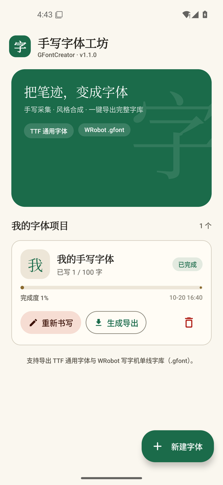
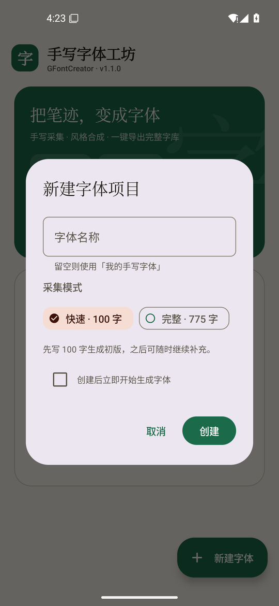
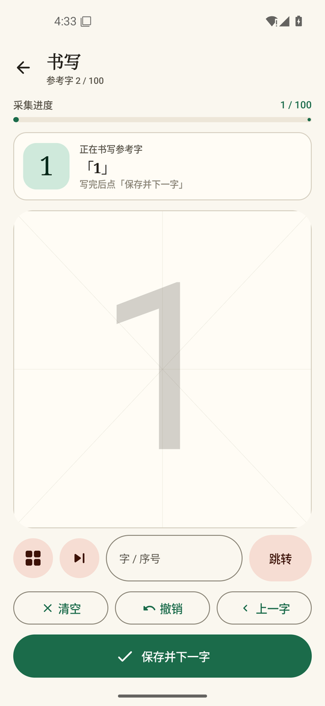
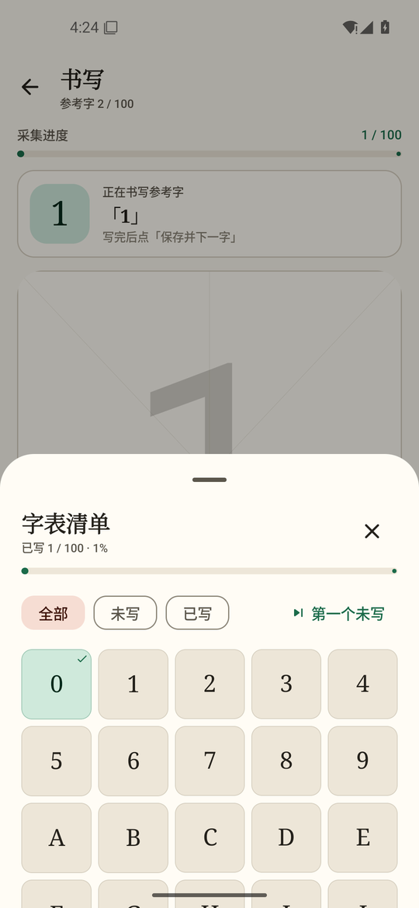
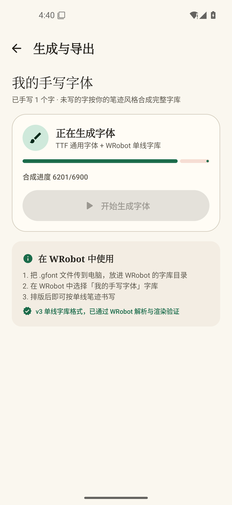
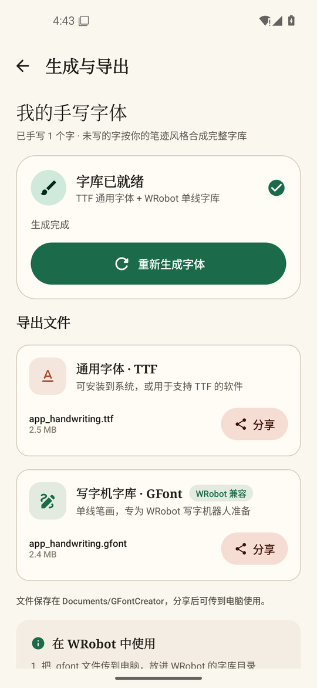
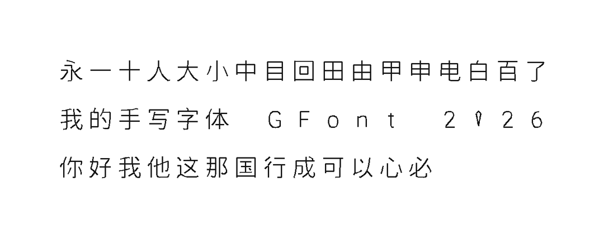
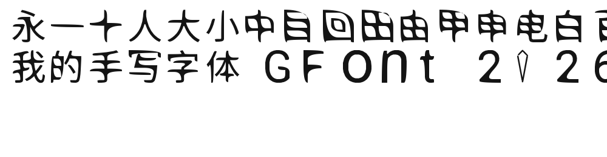

# 手写字体工坊 (GFontCreator) v1.1.0

安卓 App：在米字格中手写常用汉字 → 风格合成完整字库 → 一键导出 **TTF 通用字体** 与
**WRobot 写字机单线字库（`.gfont` v3）**。实现方案遵循 `ref.md`（三层架构 + 离线优先）。

## Release 下载

- **`app/build/outputs/apk/release/app-release.apk`** — v1.1.0（12 MB，minSdk 26 / target 35，已签名）
- 签名配置：`keystore.properties` + `app/release.keystore`（发布时勿提交到公开仓库）

## 构建

要求：JDK 17、Android SDK（platform 35 / build-tools 35）。

```bash
./gradlew assembleRelease        # Windows: gradlew.bat assembleRelease
# 产物：app/build/outputs/apk/release/app-release.apk（versionName 1.1.0）
```

## v1.1.0 更新

- **新增 WRobot `.gfont` v3 导出**：8 字节头（BE 版本号 + 元数据长度）+ 元数据前缀 + 内嵌 ZIP，
  每个字形记录为 `u16 码点 + f32 单线坐标 + 抬/落笔标记`，可被 WRobot 直接加载书写。
  之前 v1.0.x 导出的 `.gfont` 实际是 WOFF 封装，WRobot 无法识别，已彻底替换。
- **单线骨架提取重写**：连通域 → Zhang-Suen 细化 → 毛刺剪除 → 节点聚类图追踪
  （交叉点择优直行、纯环单独处理）→ 碎片合并 → Douglas-Peucker 简化 → 回折尾修剪。
  47 字端到端测试平均 **5.30 笔/字、31.1 点/字**，优于商业单线字库参考值（5.86 笔/86 点）。
- **修复 TTF 无法渲染**：轮廓追踪改为沿像素边界行走（不再陷入重复像素循环），
  闭合曲线简化不再产生退化线段；同时修正 TrueType 短向量符号位编码——此前导出的
  字形坐标会溢出 em 框，FreeType 直接报 `raster overflow`。
- **整库生成稳定性**：生成分辨率调整为 512（笔锋与轮廓质量经对比验证），先落盘 `.gfont`
  再组装 TTF，并开启 largeHeap；6900 字整库生成不再 OOM，实机（debug 模拟器）约 6 分钟。
- **界面重设计**：宣纸底色 + 青玉/朱砂配色、衬线标题、全新的主页/书写/字表/导出页；
  补齐 Material3 surfaceContainer 系列配色，深色模式同步适配；生成页显示真实百分比进度，
  导出卡片按 B/KB/MB 正确显示文件体积。
- **生成状态可恢复**：WorkManager 任务按项目打 tag，切换页面或重建 Activity 后仍能显示进度与结果；
  失败（含 OOM）会把项目状态置为失败，不再卡在「生成中」。
- **导出修复**：`.gfont` 分享 MIME 改为 `application/octet-stream`（原 `font/woff` 会被接收端改名/误判）。

## 界面与功能展示

以下截图来自安装 v1.1.0 APK 的 Android 模拟器，效果图为 App 实际导出的字体在 WRobot 与本机渲染的结果。

<table>
  <tr>
    <td align="center"><br><sub>主页 · 项目进度与一键生成</sub></td>
    <td align="center"><br><sub>新建项目 · 快速 100 字 / 完整 775 字</sub></td>
    <td align="center"><br><sub>米字格书写 · 参考字与采集进度</sub></td>
  </tr>
  <tr>
    <td align="center"><br><sub>字表清单 · 筛选与跳转</sub></td>
    <td align="center"><br><sub>整库合成 · 6201/6900 真实百分比</sub></td>
    <td align="center"><br><sub>生成完成 · 双格式导出与分享</sub></td>
  </tr>
</table>

### 功能一览

- **手写采集**：米字格 + 浅色参考字，按书写速度生成笔锋；支持撤销、清空、跳转，保存后自动进入下一个参考字。
- **风格合成**：快速模式先写 100 字生成初版，完整模式 775 字；未手写的字符按已写笔迹风格自动合成，最终覆盖 6900 个常用字。
- **进度管理**：项目卡片显示完成度、最后编辑时间；字表弹层支持全部/未写/已写筛选与「第一个未写」。
- **后台生成**：WorkManager 合成 + 矢量化整库，导出页显示真实百分比；切换页面或重建 Activity 后任务仍可跟踪，失败（含 OOM）会落到失败状态。
- **双格式导出**：`.ttf` 可安装为系统字体；`.gfont`（WRobot v3 单线字库）可直接放入 WRobot 字库目录，用于写字机排版与书写。
- **可验证性**：App 实际产出的 `.gfont` 已通过 WRobot 官方 CLI 的解析、工程排版、SVG 与 G-code 渲染验证，详见下节。

### 导出效果

<table>
  <tr>
    <td align="center"><br><sub>App 生成的 .gfont 在 WRobot 工程中排版后的单线笔迹（47 字）</sub></td>
  </tr>
  <tr>
    <td align="center"><br><sub>同一份 App 生成的 TTF 经 FreeType 渲染效果</sub></td>
  </tr>
</table>

## 与 WRobot 的兼容性验证

`WRobotGFontExportTest` 会将 47 个字符位图跑完整条「骨架 → `.gfont`」链路，并把产物写到
`tools/out/wrobot_fonts/gfc_test.gfont`，随后用真实 WRobot 工程验证：

```bash
# 1. 生成测试字库（同时输出骨架诊断图 tools/out/skeleton_preview.png）
./gradlew :app:testDebugUnitTest --tests "com.gfontcreator.app.font.WRobotGFontExportTest"

# 2. 用 WRobot 官方 CLI 解析并渲染
WRobot/target/release/wrobot-cli font  tools/out/wrobot_fonts/gfc_test.gfont
WRobot/target/release/wrobot-cli svg   tools/out/wrobot_project.json \
    --fonts tools/out/wrobot_fonts -o tools/out/wrobot_text.svg
WRobot/target/release/wrobot-cli png   --fonts tools/out/wrobot_fonts -o tools/out/wrobot_preview.png
```

验证结果：`wrobot-cli font` 正确识别版本 3 / 48 个字形 / em 500；工程排版后 47 个字符全部
以单线笔迹渲染，字距、行距与基准字库一致。测试工程见 `tools/out/wrobot_project.json`。

### App 实机产物的端到端验证

在模拟器上安装 v1.1.0 debug APK，新建「快速·100 字」项目并手写 1 个字形，
点击「开始生成」完成整库合成（6900 字，约 6 分钟，无 OOM），将 App 实际写出的文件拉回电脑：

```bash
# 产物：tools/out/app_fonts/app_handwriting.gfont（2.4 MB）与 .ttf（2.5 MB）
wrobot-cli font tools/out/app_fonts/app_handwriting.gfont
#   版本头：3  meta_len=486262
#   字形数：6896  em：500  平均笔画：9.10  平均点数：40.21

wrobot-cli svg  tools/out/wrobot_app_project.json \
    --fonts tools/out/app_fonts -o tools/out/app_wrobot_text.svg
wrobot-cli gcode tools/out/wrobot_app_project.json \
    --fonts tools/out/app_fonts -o tools/out/app_wrobot_text.nc
```

SVG（184 条 polyline）与 G-code（1039 行、185 次抬笔、坐标全部落在页面内、无 NaN）
均成功生成；把 SVG 折线栅格化后可见 47 个字符全部为可读单线笔迹。
TTF 同时经 fontTools 校验（6902 字形 / upem 1024 / 无越界坐标）并用 FreeType 渲染通过。
验证工程见 `tools/out/wrobot_app_project.json`，预览见 `tools/out/app_wrobot_render.png`。

## 参考字集

字表顺序：数字/字母/常用符号（160 字符）在前，其后为 GB2312 汉字（一级常用字优先），
总字符集 6900。说明：仓库中的 `方正兰亭.gfont` 仅用于格式对照，App 不解析或复用其字形数据；
用户手写的笔迹版权归用户所有。

## 功能与代码位置

| 模块 | 代码位置 | 说明 |
|------|----------|------|
| 手写采集 | `handwriting/` | 贝塞尔平滑 + VelocityTracker 速度剖面（笔锋）、米字格 + 浅色参考字、质量评分 |
| 识别校验 | `recognition/` | `HanziRecognizer` 接口；内置结构相似度校验，两次保存可强制收录；`NcnnRecognizer` JNI 桩 |
| 位图矢量化 | `vectorize/Vectorizer.kt` | 去噪 → Moore 轮廓追踪 → Douglas-Peucker + 二次贝塞尔 → 1024 em 归一化（TTF 用） |
| 单线骨架 | `vectorize/StrokeExtractor.kt` | 连通域 → Zhang-Suen 细化 → 毛刺剪除 → 节点聚类图追踪 → 合并 → 简化（GFont 用） |
| 风格合成 | `synthesis/` | `StyleSynthesizer` 两阶段接口；`FallbackSynthesizer` 系统字体骨架 + 统计风格 |
| 字体生成 | `font/` | `TtfBuilder`（glyf/loca/cmap/head/hhea/hmtx/maxp/name/OS2/post）；`GFontBuilder`（WRobot v3 单线字库）；`StrokeFontMapper` 画布坐标映射 |
| 项目管理 | `data/` `work/` | Room（项目/笔迹/检查点）、每 200 字检查点、WorkManager 后台生成、FileProvider 分享 |
| UI | `ui/` | 宣纸主题、主页进度、书写页、字表弹层、生成导出页 |

## 使用流程

1. 新建项目（快速模式 100 字 / 完整模式 775 参考字）
2. 在米字格逐字手写；可用字表清单、跳转、第一个未写来规划顺序
3. 「生成与导出」→ 后台合成并矢量化完整字库 → 产出 TTF + `.gfont`
4. TTF 可直接安装为系统字体；`.gfont` 复制到 WRobot 字库目录后即可选择并单线书写

## 生产化路线（当前降级项）

- **识别模型**：下载 Handwritten 项目 NCNN INT8 模型（~4.1MB）放入 `assets/ncnn/`，实现 `NcnnRecognizer` 的 native 层
- **风格迁移模型**：按 ref.md 训练骨架变形 + GAN 渲染网络（CASIA-HWDB），替换 `FallbackSynthesizer`
- **测试夹具**：`tools/GlyphFixture.java` 用系统字体预渲染位图；Android 单测类路径无 `java.awt`，
  新增字符时可用 `javac -encoding UTF-8 tools/GlyphFixture.java -d tools/build` 重新生成
  `app/src/test/resources/glyph_fixture.bin`
